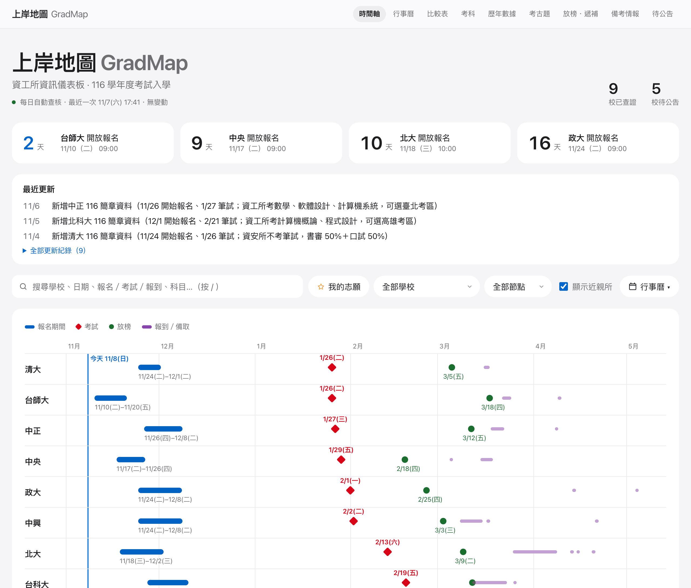
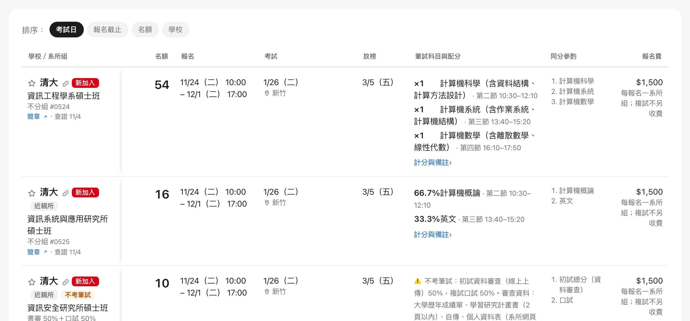
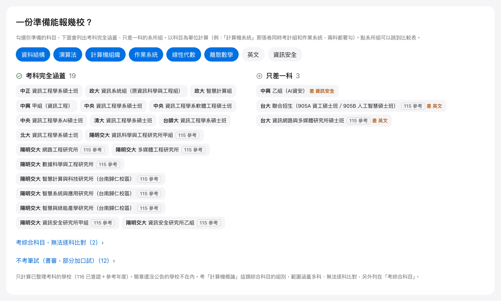
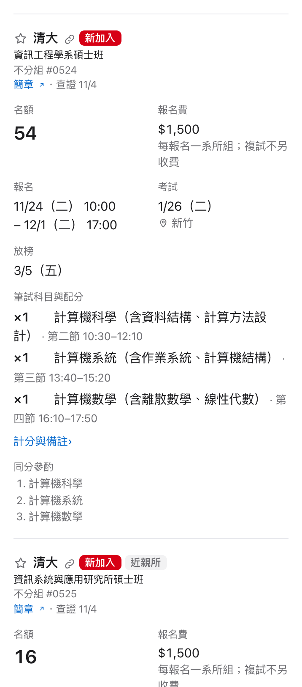

# GradMap 上岸地圖

**A verified dashboard for Taiwan's CS graduate school entrance exams (資工所考試入學).**
Deadlines, exam dates, quotas, subjects and score weights from each school's official admission brochure — every number links back to the page it came from.

> 資工所「考試入學」資訊儀表板：報名日程、名額、考科、計分比例，每一筆都附官方簡章頁碼。

🔗 **Live site 網站：<https://gradmap-tw.vercel.app>**

[](https://gradmap-tw.vercel.app)
[](https://github.com/TTigger/gradmap/actions/workflows/check-watchdog.yml)
[](LICENSE)
[](LICENSE-DATA)

<picture>
  <source media="(prefers-color-scheme: dark)" srcset="docs/images/hero-dark.png">
  
</picture>

<sub>Screenshot from November 2026; the live site has the latest data. 截圖為 2026 年 11 月畫面，最新資料以網站為準。</sub>

---

## Features 功能

| | English | 中文 |
|---|---|---|
| 🗓 | **Timeline & calendar** — registration, exam, results and enrollment dates, with weekday and conflict warnings | 時間軸與月曆：報名、考試、放榜、報到，標星期幾與撞期提醒 |
| 📊 | **Compare table** — quotas, papers, weights and tie-breakers across schools, with live registration status (open · N days left / closed) | 比較表：名額、試卷、配分、同分參酌，報名期間顯示「報名中・N 天後截止」 |
| 🧮 | **Prep planner** — tick the subjects you study, see which programs you can apply to | 一份準備能報幾校：勾選準備科目，列出考科完全涵蓋／只差一科的組別 |
| ★ | **My list** — pick schools, see total fees, share via link, export `.ics` | 我的志願：報名費合計、分享連結、匯出行事曆 |
| 📍 | **Itinerary** — exam venues and back-to-back travel warnings | 考場與行程：連考、跨縣市提醒 |
| 📚 | **Past exams index** — where each school publishes past papers, and which years | 考古題索引：官方位置與可取得年度 |
| 📬 | **Results & waitlist** — deadlines you lose your place for missing | 放榜・遞補：不做就喪失資格的期限 |
| 📈 | **History (113–115)** — applicants, admitted, minimum scores from official statistics | 歷年數據：報名、錄取、最低錄取分數 |
| 🔔 | **Change markers** — brochure corrections highlighted for 45 days | 簡章更正標記 |
| 🔗 | **Link to one program** — the 🔗 button next to a school copies a link that opens the compare table at that program (also on each school's history card) | 單一系所連結：比較表學校名稱旁的連結按鈕，複製後打開會直接捲到該系所組；歷年數據每所學校的標題旁也有 |
| ⏳ | **Countdown** — the next registration opening, deadline or exam for each school, with 今天 on the day itself | 倒數：各校下一個開放報名／截止／考試，當天標「今天」 |
| 📱 | **Phone-friendly** — the compare table and past-exam index become one card per program; works in light and dark mode | 手機好讀：比較表、考古題在手機上改成一張張卡片，支援深色模式 |
| 🖨 | **Print / PDF** — prints in light colors without buttons and filters; wide tables fit the page | 列印／存 PDF：淺色、去掉按鈕與篩選、寬表格縮到紙寬 |
| ⌨️ | **Accessible** — arrow keys switch tabs, contrast meets WCAG AA, screen-reader labels | 無障礙：方向鍵切換分頁、文字對比符合 AA、螢幕報讀標籤 |

Scope 範圍: **exam-based admission only** (no 甄試/推甄). Near-kin programs (網媒、網工、資安…) are included, labeled, and can be hidden.

Schools 學校: 台大、清大、陽明交大、成大、政大、台師大、中央、中興、中山、中正、台科大、北科大、台北大學、海大.
A school appears once its 116 brochure is published and checked; until then the site shows last year's (115) data marked as reference, or lists it under 待公告 (awaiting brochure). The site header shows the current count.
簡章公布並核對後才收錄；還沒公布的學校標「115 參考」或列在「待公告」，目前數量以網站上方顯示為準。

<table>
<tr>
<td width="55%" valign="top">

**Compare table 比較表** — quotas, papers, weights, tie-breakers and fees side by side; programs without a written exam are flagged.

<picture>
  <source media="(prefers-color-scheme: dark)" srcset="docs/images/compare-dark.png">
  
</picture>

</td>
<td width="45%" valign="top">

**Prep planner 一份準備能報幾校** — tick the subjects you study; see every program whose papers you fully cover, or miss by one.

<picture>
  <source media="(prefers-color-scheme: dark)" srcset="docs/images/planner-dark.png">
  
</picture>

</td>
</tr>
</table>

<table>
<tr>
<td width="38%" valign="top">

**On your phone 手機版** — each program is a card: quota, fee, dates, papers and tie-breakers, no sideways scrolling.

手機上每個系所一張卡片，名額、報名費、日期、考科一次看完，不用左右滑。

</td>
<td width="62%" valign="top">

<picture>
  <source media="(prefers-color-scheme: dark)" srcset="docs/images/mobile-dark.png">
  
</picture>

</td>
</tr>
</table>

## Data trust 資料可信度

| Grade | Source | May change facts? |
|---|---|---|
| **A** | Official brochure / admission site 官方簡章、招生網站 | ✅ Yes |
| **B** | Third party (news, cram schools) 第三方 | ❌ Lead only 只當線索 |
| **C** | Senior students' notes 前輩心得 | ❌ Prep tips only 只放備考情報 |

Page refs 頁碼寫法: `p42 / 38` = PDF page 42 / printed page 38.
`scripts/verify-src.mjs` checks that every date, quota, weight and fee actually appears on the cited page.

## Development 開發

```bash
npm install
npm run dev        # YAML → src/generated/data.json, then Vite dev server
npm run build      # validate data + type-check + build to dist/
```

Requires Node 18+ to build; `scripts/smoke.mjs` and `scripts/screenshots.mjs` need Node 22+ (built-in WebSocket) and Google Chrome. Data lives in YAML; the site is a static Vite + React build, deployed on Vercel — every push to `main` goes live automatically（推送到 main 會自動部署）.

## Project layout 資料夾結構

```
data/
  registry.yaml          14 schools: aliases, admission sites, stats locations
  subjects.yaml          canonical subject codes (LA/DM/DS/ALG/CO/OS/EN…) and aliases
  schools/<id>.yaml      per school: schedule, programs, groups, quotas, papers, scoring
  pending.yaml           schools whose 116 brochure is not out yet
  history/<id>.yaml      113–115 statistics (published = shown on site)
  past_exams.yaml        past exam paper index
  resources.yaml         prep resources, graded A/B/C
shared/ics.mjs           .ics generator (used by build and browser)
scripts/
  build-data.mjs         YAML → JSON + .ics, with validation
  verify-src.mjs         cross-check data against brochure text
  smoke.mjs              open every tab of the built site in headless Chrome; fail on errors
  extract.sh             PDF → per-page text (local only)
  daily-check.sh         daily re-check on branch check/<date>, auto-publish if checks pass
  schedule.sh            install / uninstall / run the daily job (macOS launchd)
  screenshots.mjs        README screenshots (desktop + phone), light + dark (headless Chrome)
sources/<year>/SHA256SUMS  fingerprints of the brochures used (PDFs stay local)
docs/                    decisions, research logs, daily-check instructions (DAILY_CHECK.md)
docs/images/             README screenshots
```

## Daily check 每日查核

`scripts/schedule.sh install` runs a check every day at 12:10 and 17:40 Taiwan time (2026-11-02 → 2027-04-30) and posts the result as a macOS notification and a phone push (ntfy; topic kept in the untracked `.env.ntfy`). It looks for newly published 116 brochures and corrections on a branch `check/<date>-<time>`. Changes go live automatically **only if** they touch data files only, `npm run build` passes, `verify-src.mjs` finds every date / quota / weight on its cited brochure page, and every tab of the built site opens without errors in headless Chrome (`scripts/smoke.mjs`); otherwise the branch is kept for manual review. Sunday's midday run also refreshes history stats, past exams and resource links. A GitHub Actions watchdog (`.github/workflows/check-watchdog.yml`) fails around 21:17 if no check ran that day, which triggers GitHub's failure email.

每天自動查新簡章與更正公告。只改資料檔、建置通過、簡章頁碼全數核對成功、網站每個分頁都能正常打開，才會自動推上 main 並更新網站；否則留在分支等人工確認。週日另外補歷年數據、考古題與備考連結。

## Contributing 回報錯誤

Found a wrong date or number? [Report a data error](https://github.com/TTigger/gradmap/issues/new?template=data-error.yml) with the **school, field, and the official source (URL + page)**. Only grade-A sources change data. Other ideas: [open an issue](https://github.com/TTigger/gradmap/issues/new/choose).
發現資料有誤，請用[資料錯誤回報表單](https://github.com/TTigger/gradmap/issues/new?template=data-error.yml)，附上官方來源網址與頁碼；其他建議請[開 issue](https://github.com/TTigger/gradmap/issues/new/choose)。

## Disclaimer 免責聲明

This is an independent, unofficial compilation by an individual and is not affiliated with any university. Data may contain errors or be out of date and is provided "as is", without warranty. Always confirm with each university's official brochure and announcements before registering or taking exams.
本站為個人整理、非官方網站，與各校無關。資料可能有誤或過時，依現狀提供、不負擔保；報名與應考請以各校簡章及公告為準。

## License 授權

- Code: [MIT](LICENSE)
- Data (`data/`): [CC BY-NC 4.0](LICENSE-DATA) — free for non-commercial use with credit ("GradMap, https://gradmap-tw.vercel.app"); commercial use requires permission.
- 程式碼採 MIT；`data/` 資料採 CC BY-NC 4.0：非商業使用請標示出處，商業使用（含收費課程、付費服務）須事先取得同意。各校簡章原檔屬各校所有，本 repo 不轉載，只附官方連結。
